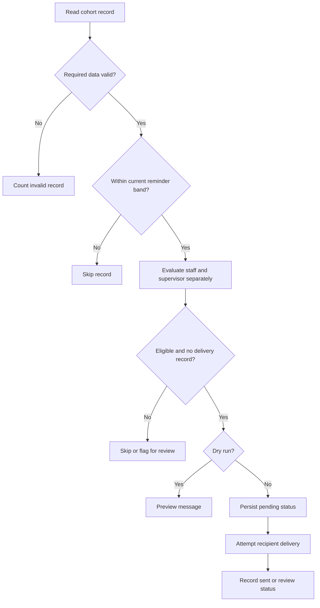

# Automated certification reminder tracker

A Google Apps Script portfolio project by Aly Nichols demonstrating how I approach a recurring administrative problem: tracking approaching certification expirations, contacting the right people, and keeping a record of reminders without repeatedly sending the same message.

This repository recreates a workflow I originally built for a nursing program. I no longer have access to the original workbook. The code and workbook generator here are a demonstrative reconstruction with entirely fictional records, not an export of employer data or a recovered copy of the original system.

**Try it:** run the local demo below. It generates seven reminder previews, simulates a first delivery run, and shows that a second run does not send them again. No Google account, original spreadsheet, external packages, or actual email delivery is required.

## What this demonstrates

- Turning a manual spreadsheet process into a repeatable, scheduled workflow.
- Processing certification cohorts and personalizing staff and supervisor messages.
- Handling dates, duplicate records, invalid input, and manually flagged addresses.
- Keeping independent delivery records so a supervisor failure does not resend a successful staff reminder.
- Designing for review and recovery when email sending and log updates cannot happen in one transaction.
- Documenting the system so another person can understand and test it.

## Run the local demonstration

Requirements: Node.js 20 or newer. There are no dependencies to install.

```bash
npm run demo
npm test
```

The demo uses the actual `.gs` source through an in-memory adapter for Google services. It is not a second implementation of the reminder rules.

Expected summaries:

```text
Dry-run preview:              sent 0, previewed 7
First simulated delivery:     sent 7
Second simulated delivery:    sent 0
```

The console lists recipients and reminder stages. Open `examples/email-preview.html` in a browser to inspect one generated HTML email; a sample is included and the demo regenerates it. All addresses use `example.com`. Simulated messages are captured in memory, never sent.

## Recreate the spreadsheet in Google Apps Script

1. Create a blank project at [Google Apps Script](https://script.google.com/).
2. Copy `src/Code.gs` and `src/Demo.gs` into two script files in that project.
3. Leave `CONFIG.DRY_RUN` set to `true`.
4. Run `runDemo` and authorize access when Google requests it. The function creates a new synthetic workbook; it does not need access to the original.
5. Open the workbook URL in the execution log. Inspect the cohort tabs and **Demo Preview** tab.
6. Edit synthetic records, then run `previewDemoReminders` to refresh previews in that same workbook.

`runDemo` creates a new workbook each time. `previewDemoReminders` reuses the latest one. Neither creates an email trigger or sends email. `src/appsscript.json` supplies a V8/Pacific-time manifest for project import, but manual copying can use the editor's default manifest.

The demo workbook includes:

| Tab | Purpose |
| --- | --- |
| Read me | Explains the synthetic dataset and how to refresh the preview. |
| No Prior Recerts | First-renewal cohort with upcoming and catch-up examples. |
| One Prior Recert | Experienced cohort including a red-flagged staff address. |
| Two+ Prior Recerts | Outside-window, expired, invalid-address, and duplicate examples. |
| Demo Preview | Recipient, role, credential, date, stage, subject, and message text. |

## How the reminder rules work



The stages use fixed days rather than exact calendar months:

| Days remaining | Stage |
| --- | --- |
| 91-180 | Six-month planning stage |
| 31-90 | Three-month action stage |
| 0-30 | One-month urgent stage |
| More than 180 or already expired | No reminder from this workflow |

A record first added at 45 days gets the current three-month stage, rather than every earlier stage. Messages state the actual date and days remaining. Date comparisons use the workbook timezone to avoid elapsed-hour errors around daylight saving changes.

A delivery key includes the staff address, credential, expiration date, stage, recipient address, and recipient role. That separates renewal cycles and staff/supervisor deliveries. Duplicate rows do not produce duplicate messages for the same key.

Red background on an email cell represents a **manually flagged** bounced or invalid address. This recreation does not scan an inbox or automatically detect bounces. A flagged staff address does not block a valid supervisor notice.

## Design decisions

**Preview first.** A reviewer can see the message output without configuring a sending account. Preview mode does not write successful-delivery records.

**Separate recipients.** Each recipient has an independent delivery state. The supervisor email template does not assume the staff email succeeded.

**Keep uncertain deliveries visible.** In sending mode, the script writes `PENDING` before contacting Gmail. It writes `SENT` afterward, or `ERROR` if the send attempt throws. Existing unresolved entries block automatic retries so an uncertain send is reviewed instead of silently duplicated. This favors manual recovery over automatic duplicate messages.

**Make operational exceptions explicit.** Missing tabs and unexpected log schemas fail visibly. Expired records require a separate administrative follow-up; this workflow does not verify that a certification was renewed.

**Keep credential guidance general.** Different issuers have different requirements. The email directs recipients to current issuer guidance instead of hardcoding a universal renewal process. Optional Drive attachments are supported but are not required for the demo.

## Repository contents

| File | What to review |
| --- | --- |
| `src/Code.gs` | Main workflow, date rules, recipient checks, delivery log, email templates, optional trigger setup. |
| `src/Demo.gs` | Complete synthetic workbook generator and preview output. |
| `examples/run-demo.cjs` | Runs the source locally and demonstrates duplicate prevention. |
| `examples/mock-apps-script.cjs` | Minimal in-memory Google services adapter; no external connections. |
| `examples/email-preview.html` | Generated example message. |
| `test/tracker.test.cjs` | Fourteen behavior and failure-path checks. |
| `test/demo.test.cjs` | Five checks covering workbook creation, preview, and simulated deliveries. |
| `docs/technical-notes.md` | Schema, state recovery, testing boundaries, and optional sending setup. |

## Validation

All **19 local checks pass** with mocked services. They cover repeated runs, new renewal keys, supervisor failure, dry run, flagged cells, threshold bands, quota exhaustion, invalid inputs, HTML escaping, unresolved delivery records, duplicate source rows, missing tabs, calendar-day arithmetic, and the complete synthetic demo.

The reconstruction has not been deployed or tested against live Google services. The repository demonstrates the design and executable logic; it does not claim measured compliance improvements from this recreation. No original records or screenshots are included.

## Portfolio description

> Recreated a Google Apps Script certification tracking workflow originally built for a nursing program. The self-contained sample generates a synthetic workbook, previews personalized reminders, tracks deliveries by recipient and renewal cycle, and demonstrates duplicate prevention and exception handling. Includes a local demo and 19 automated checks without exposing employer data.

Skills: Google Apps Script, JavaScript, spreadsheet automation, workflow design, systems thinking, testing, and technical documentation.

## Google service references

- [SpreadsheetApp](https://developers.google.com/apps-script/reference/spreadsheet/spreadsheet-app)
- [Properties service](https://developers.google.com/apps-script/guides/properties)
- [GmailApp](https://developers.google.com/apps-script/reference/gmail/gmail-app)
- [LockService](https://developers.google.com/apps-script/reference/lock/lock-service)

Reference links document the Google APIs used; the examples and workflow in this repository are specific to this portfolio recreation.
